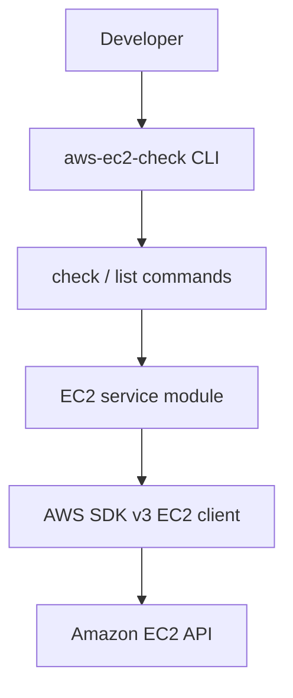

# aws-ec2-check

A small, focused CLI that inspects AWS EC2 instance health and basic metadata from your terminal — without opening the AWS Console.

## Features

- Check a single instance: state, type, networking, AMI, security groups, and status checks
- List instances in a readable table
- Filter lists by state, Name tag, or arbitrary tags
- Machine-readable `--json` output for scripts
- Region override via `--region` (otherwise uses the AWS SDK default chain)
- Clear exit codes for CI and automation
- Least-privilege IAM policy documented in-repo

## Why this project?

EC2 health checks are a common day-to-day task. This CLI keeps that workflow local, scriptable, and permission-minimal — useful for learning AWS, debugging environments, and portfolio-quality open source.

## Installation

```bash
npm install -g aws-ec2-check
```

Or run from source:

```bash
git clone https://github.com/YOUR_GITHUB_USERNAME/aws-ec2-check.git
cd aws-ec2-check
npm install
npm run build
npm link
```

Requires **Node.js 18+**.

## Authentication

This CLI uses the **AWS SDK for JavaScript v3 default credential provider chain**. It never hardcodes credentials.

Supported sources include:

- Shared AWS config/credentials (`aws configure`)
- Environment variables (`AWS_ACCESS_KEY_ID`, `AWS_SECRET_ACCESS_KEY`, optional session token)
- IAM roles (EC2 instance profile, ECS task role, Lambda role, etc.)

Example with the AWS CLI:

```bash
aws configure
aws-ec2-check i-0123456789abcdef0
```

Never commit access keys. Never paste secrets into issues or pull requests.

## Usage

### Check one instance

```bash
aws-ec2-check i-0123456789abcdef0
```

Example output:

```text
EC2 Instance Health

Instance ID        i-0123456789abcdef0
Name               example-api
State              running
Instance Type      t3.medium
Region             us-east-1
Availability       us-east-1a
Public IP          18.0.0.1
Private IP         10.0.0.5
Private DNS        ip-10-0-0-5.ec2.internal
AMI ID             ami-0123456789abcdef0
Launch Time        2024-01-15T12:00:00.000Z
VPC ID             vpc-0123456789abcdef0
Subnet ID          subnet-0123456789abcdef0
Security Groups    web, ssh

System Check       passed
Instance Check     passed

Overall Status     HEALTHY
```

Values above are **examples**. Your output depends on the instance and account.

### List instances

```bash
aws-ec2-check list
```

Example:

```text
INSTANCE ID            NAME            STATE      TYPE        AZ
i-0123456789abcdef0    Production API  running    t3.medium   us-east-1a
i-0987654321fedcba0    Staging API     stopped    t3.small    us-east-1b
```

### JSON output

```bash
aws-ec2-check i-0123456789abcdef0 --json
```

JSON mode prints **valid JSON only** (no decorative formatting), suitable for piping into other tools.

### Region

```bash
aws-ec2-check i-0123456789abcdef0 --region us-east-1
aws-ec2-check list --region ap-southeast-1
```

If `--region` is omitted, the AWS SDK resolves the region from the environment / shared config / IMDS as usual.

### Filtering

```bash
aws-ec2-check list --state running
aws-ec2-check list --state stopped
aws-ec2-check list --name "Production API"
aws-ec2-check list --tag Environment=production
```

`--name` performs a case-insensitive substring match on the `Name` tag after listing.

## IAM permissions

Minimum read-only policy: [`docs/iam-policy.json`](docs/iam-policy.json)

Explanation: [`docs/IAM.md`](docs/IAM.md)

Required actions:

- `ec2:DescribeInstances`
- `ec2:DescribeInstanceStatus`

The CLI cannot modify infrastructure with these permissions.

## Exit codes

| Code | Meaning                                                                    |
| ---- | -------------------------------------------------------------------------- |
| `0`  | Success / instance healthy (or successful list)                            |
| `1`  | Unhealthy instance, not found, access denied, or other operational failure |
| `2`  | Invalid CLI usage (bad instance ID, bad flags, missing args)               |

## Troubleshooting

| Problem               | What to check                                                       |
| --------------------- | ------------------------------------------------------------------- |
| Credentials not found | Run `aws configure`, or set standard AWS env vars / use an IAM role |
| Access denied         | Attach the policy in `docs/iam-policy.json`                         |
| Instance not found    | Confirm instance ID, region (`--region`), and AWS account           |
| Wrong region          | Pass `--region` or set `AWS_REGION` / `AWS_DEFAULT_REGION`          |
| Need more detail      | Add `--debug` (never prints credentials)                            |

## Development

```bash
npm install
npm run typecheck
npm run lint
npm test
npm run build
```

Optional integration tests (real AWS; not run in CI):

```bash
AWS_EC2_CHECK_INTEGRATION=true AWS_REGION=us-east-1 npm run test:integration
```

## Architecture



- **CLI** parses args and exit codes
- **Commands** orchestrate validation and formatting
- **EC2 service** owns AWS API calls and pagination
- **Formatters** produce terminal or JSON output

## Contributing

See [CONTRIBUTING.md](CONTRIBUTING.md).

## Security

See [SECURITY.md](SECURITY.md).

## License

MIT — see [LICENSE](LICENSE).

Replace `YOUR_NAME` / `YOUR_GITHUB_USERNAME` placeholders in `package.json`, `LICENSE`, and this README before publishing.
